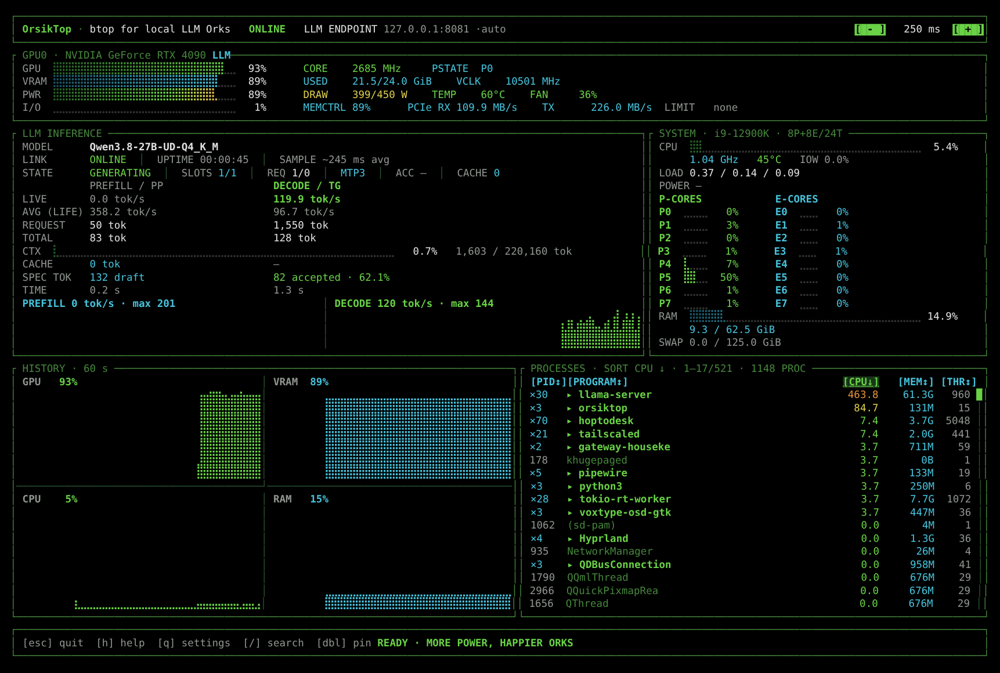
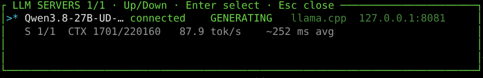

# OrsikTop

**Fast terminal monitoring for local LLM Orks.**

[](https://github.com/exclude-barrier/OrsikTop/releases/latest)
[](https://github.com/exclude-barrier/OrsikTop/actions/workflows/ci.yml)
[](LICENSE)

OrsikTop brings **LLM inference, GPU telemetry, Linux system load and processes** into one terminal dashboard. Monitor llama.cpp or Strata endpoints alongside the machine running OrsikTop, without a browser, daemon, database or account. Monitoring is read-only: OrsikTop does not start, stop or reconfigure your inference servers.



*Live llama.cpp inference on `test-desktop`: Qwen3.8-27B, RTX 4090 and local CPU/GPU telemetry. Sensor fields marked `—` are unavailable, not measured zeroes.*

[Quick start](#quick-start) · [Everyday use](#everyday-use) · [Compatibility](#compatibility-and-limits) · [Documentation](#documentation)

## Highlights

- **Inference at a glance:** live prefill and decode rates with 60-second rate histories, lifetime averages, context occupancy, request progress, slots and speculative-decoding metrics when the backend exposes them.
- **Multiple servers:** monitor up to 16 endpoints concurrently, with separate connection state and throughput history. Servers poll independently, so a slow endpoint never delays the healthy ones. Switch servers without losing their histories.
- **Settings in the TUI:** add, edit and remove additional endpoints; change GPU selection and refresh settings without restarting.
- **GPU and system telemetry:** NVIDIA, AMD and Intel backends, CPU/core activity, RAM, swap, sensors and 60-second histories. Available metrics depend on hardware, drivers and permissions.
- **Interactive processes:** sort, search, group and pin processes, with per-process GPU telemetry where available.
- **Explicit uncertainty:** unknown LLM fields show `—`; held samples are marked stale. Unknown activity is not guessed to be idle.

## Quick start

You need **Linux x86_64** for the prebuilt release and `curl` for the installer. Rust is not required. GPU readings need a working vendor driver; LLM readings need a reachable supported server. Missing telemetry does not prevent the rest of the dashboard from working.

**1. Install the latest release:**

```bash
curl --proto '=https' --tlsv1.2 -LsSf \
  https://github.com/exclude-barrier/OrsikTop/releases/latest/download/orsiktop-installer.sh | sh
```

This downloads and runs the release installer. For manual downloads, Cargo installation, PATH setup and release verification, see [Installation](docs/INSTALLATION.md).

**2. Start llama.cpp with metrics enabled** if you do not already have a server:

```bash
llama-server -m /path/to/model.gguf --metrics
```

The `llama serve` form also works:

```bash
llama serve -hf user/model:Q4_K_M --metrics
```

**3. Open the dashboard:**

```bash
orsiktop
```

Local llama.cpp servers are discovered automatically. For a fixed or remote endpoint, including Strata, use:

```bash
orsiktop --server http://HOST:PORT
```

Auto discovery only inspects local processes; it does not scan your LAN. See [Server discovery](docs/USAGE.md#server-discovery) for selection rules.

## Everyday use

| Action | Control |
| --- | --- |
| Help and metric legend | `h` |
| Settings and additional server list | `q` |
| Server selector | `s` |
| Search processes | `/` |
| Navigate processes | `↑` / `↓`, `j` / `k`, `PgUp` / `PgDn` |
| Change refresh interval | `-` / `+`, or click `[ - ]` / `[ + ]` |
| Quit dashboard / close dialog | `Esc` |

Press `s`, move with `↑` / `↓`, then press `Enter` to select a server. The selector shows connection state, activity phase, sample age, backend, slots, context and throughput.



*Server selector during the same inference run, with activity phase, backend, slots, context, live decode rate and sample interval.*

To manage endpoints, open **`q` → SERVER LIST**: `a` adds, `e` edits and `d` removes an additional endpoint. `Enter` keeps an entry; `Enter` outside entry editing saves the whole dialog. `Esc` discards the current entry or dialog. The primary endpoint stays in the Host/IP and Port fields.

Update a standalone installation with:

```bash
orsiktop update
```

There are no automatic background update checks. Full controls, configuration, CLI overrides and telemetry definitions are in the [Usage guide](docs/USAGE.md).

## Compatibility and limits

- **Platform:** Linux. Prebuilt releases target `x86_64-unknown-linux-gnu`; macOS and Windows are not supported.
- **Backends:** llama.cpp Prometheus `/metrics` and Strata JSON `/metrics` are detected from their responses, not merely from a reachable URL. Strata endpoints must be configured explicitly. Strata does not expose instantaneous prefill throughput; older slot schemas also lack current context occupancy.
- **GPUs:** NVIDIA uses NVML; AMD uses amdgpu sysfs/hwmon; Intel uses i915/xe sysfs/hwmon. Metrics are not identical across vendors. AMD hardware and NVIDIA MIG remain fixture-tested, not live-verified. See the [hardware support matrix](docs/HARDWARE_SUPPORT.md) and [backend compatibility reference](docs/BACKEND_VERSIONS.md).
- **Remote servers:** LLM telemetry can come from remote endpoints. CPU, RAM, GPU and process panels describe the machine running OrsikTop, not the remote host. Remote server-to-GPU association remains unknown.
- **Server limit:** at most 16 servers are polled. Extra configured endpoints are retained and marked **NOT MONITORED — limit reached**, not reported as offline.
- **Terminal size:** the full dashboard needs at least **72×22** cells. A reduced layout works from **54×16**; smaller terminals show a resize notice.
- **Measurements:** `CTX` is reported slot context occupancy, not request progress or exact physical KV-cache use. `REQUEST` describes the in-flight request. Unavailable values stay `—`.

## Troubleshooting

- **`orsiktop: command not found`:** activate `~/.local/bin` in your shell. See [PATH setup](docs/INSTALLATION.md#path-setup).
- **Offline or incomplete LLM telemetry:** check the endpoint and ensure llama.cpp was started with `--metrics`. `/slots` is optional; missing fields remain unavailable. See [Telemetry troubleshooting](docs/USAGE.md#troubleshooting).
- **Missing GPU readings:** check drivers, permissions and the [hardware support matrix](docs/HARDWARE_SUPPORT.md). Not every GPU exposes every metric.

For a bug report, collect the read-only diagnostics:

```bash
orsiktop diag
orsiktop diag --servers
```

Diagnostics redact endpoint credentials, paths and query values. Review the report before publishing it: it still contains hardware details, hostnames and addresses.

## Documentation

- [Installation](docs/INSTALLATION.md): standalone and Cargo installs, shell PATH, updating, uninstalling, checksums and attestations.
- [Usage](docs/USAGE.md): controls, settings, multi-server behavior, configuration, CLI and metric meanings.
- [Development](docs/DEVELOPMENT.md): source build, module responsibilities and validation commands.
- [Hardware support](docs/HARDWARE_SUPPORT.md) and [hardware test matrix](docs/HARDWARE_TEST_MATRIX.md): implemented paths, live evidence and remaining gaps.
- [Backend versions](docs/BACKEND_VERSIONS.md) and [live vs fixture evidence](docs/LIVE_VS_FIXTURE.md): telemetry schema support and verification limits.
- [Changelog](CHANGELOG.md) and [releases](https://github.com/exclude-barrier/OrsikTop/releases).

## Contributing

Bug reports and focused feature requests are welcome through [GitHub Issues](https://github.com/exclude-barrier/OrsikTop/issues). Include your OrsikTop version, expected behavior, steps to reproduce and reviewed diagnostics where useful. Keep changes focused on making monitoring clearer and more useful.

For source builds and checks before submitting changes, see [Development](docs/DEVELOPMENT.md).

## License

Apache License 2.0. See [LICENSE](LICENSE) and [NOTICE](NOTICE).
